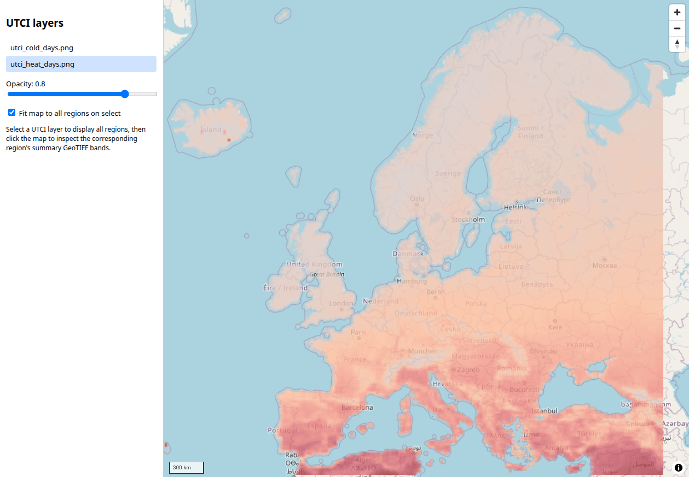

# 🗺️🌡️ Thermal Comfort Indices Map

Download yearly **UTCI** (Universal Thermal Climate Index) statistics for European regions and turn them into GeoTIFF summaries, heat- and cold-stress PNG maps, and JSON metadata. The frontend displays regional layers and lets you click the map to inspect source-pixel values, including median yearly day counts and record UTCI values and years.

<p align="center">
  
</p>

## 🛰️ Data source

[Copernicus ERA5 single-level reanalysis](https://cds.climate.copernicus.eu/datasets/reanalysis-era5-single-levels?tab=overview) provides the broader climate-data context. The downloader requests precomputed yearly UTCI statistics from the CDS dataset `derived-utci-historical`, version `1_1`. The configured period is 2016–2025.

## ⚙️ Setup

Requires Python 3.12+, `uv`, and Node.js for frontend tests. Install the Python dependencies declared in `pyproject.toml`, including CDS API, Rasterio, Matplotlib, NetCDF4, SciPy, xarray, and pytest:

```sh
uv sync
```

Run all commands from the project root.

Configure CDS API credentials for `cdsapi.Client()` before running the scripts. Both processing entry points import the download module, which also creates a CDS client at import time.

The application-map pipeline also requires **GISCO** coastline data from Eurostat’s GISCO service, stored at `gisco/COAS_RG_10M_2016_4326.geojson`. 

Paths, map styling, and processing years are configured in `utci_map/source/config.py`; keep its years consistent with `thermal_dataset_download.py`. 

Rasterio/GDAL must support reading NetCDF files.

## 📥 Download and process

Download one ZIP archive per configured region into `downloads/`:

```sh
uv run python thermal_dataset_download.py
```

Generate the application’s regional GeoTIFFs, PNGs, and JSON sidecars under `output/map/<region>/`:

```sh
uv run python -m utci_map
```

Generate standalone previews from downloaded archives under `output/preview/<archive-stem>/`. This preview script leaves sea pixels visible and writes progress and errors to `output/preview/thermal_dataset_preview.log`.

```sh
uv run python thermal_dataset_preview.py
```

## 🗺️ Run the application

Serve the repository root so the frontend and generated outputs are available together:

```sh
uv run python -m http.server 8000
```

Open `http://localhost:8000/frontend/`. Select a UTCI layer, adjust its opacity, and click a location to inspect the corresponding region’s summary GeoTIFF. Day counts represent median yearly counts. Point values come directly from the containing source pixel. The application pipeline masks sea pixels in PNGs while preserving the original GeoTIFF values.

## 🧪 Tests

Run the Python suite:

```sh
uv run pytest
```

Run the downloader tests:

```sh
uv run pytest tests/test_thermal_dataset_download.py
```

Run the frontend module tests:

```sh
node --experimental-default-type=module --test frontend/tests/modules.test.mjs
```